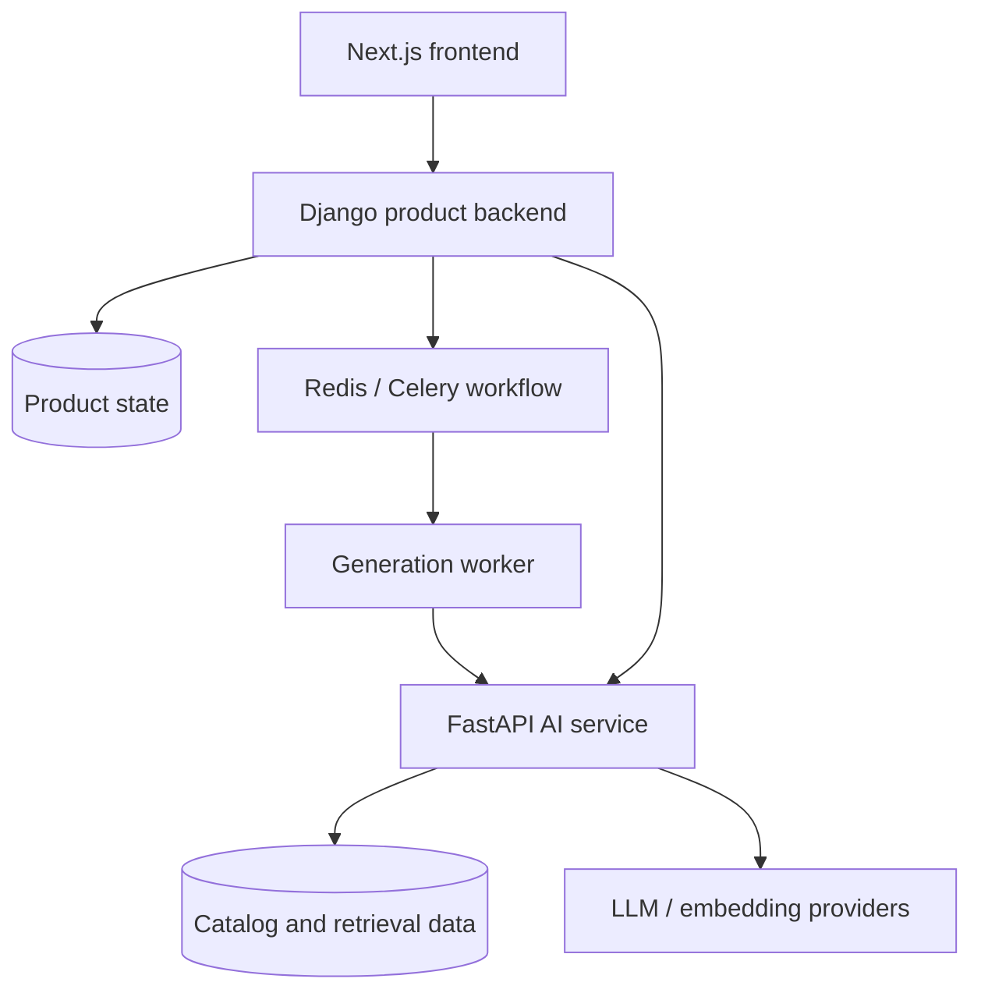

  

  <h1>CELEST</h1>

  <strong>AI-assisted admissions decision support for international applicants to Chinese universities.</strong>

    

  
  
  
  

   

  Explainable recommendations, traceable evidence, and reliable AI execution.

CELEST is an independently developed decision-support platform for international applicants to Chinese universities, with a broader vision of supporting students from university selection and admission through academic planning and career development during their studies in China.

It combines rule-based eligibility checks, interpretable scoring, and evidence retrieval, with an emphasis on result provenance and reliable AI workflows.

## Project status

**Active development · Preparing for a closed pilot**

CELEST is undergoing integration testing and deployment verification ahead of a closed pilot.

This repository currently presents the system overview and architecture. Standalone examples, engineering case studies, and reproducible evaluations will be added incrementally.

## System Architecture

The diagram shows logical responsibilities. It does not prescribe the number of deployed database instances or establish the current production deployment topology.

| Component | Responsibility |
| --- | --- |
| Frontend | Localized onboarding, strategy presentation, and applicant workspace |
| Product backend | Authentication, ownership, session state, orchestration, documents, and learning state |
| AI service | Profile normalization, eligibility, scoring, retrieval, and strategy explanations |
| Worker layer | Background execution where enabled by the runtime configuration |
| Data layer | Product persistence, structured catalog records, and retrieval indexes |

The browser communicates with the product backend. Internal AI-service requests use service-to-service authentication.

## Engineering Highlights

### Reliable AI Execution

An AI provider may complete a paid request even when the application never receives the response. That uncertainty affects both recovery and cost accounting.

Generation attempts are associated with input snapshots and profile revisions. Returned artifacts are checked against their originating attempt before they can replace the current result, accounting for changed profiles and superseded attempts.

Budget reservations and dispatch controls address concurrent requests and duplicate execution. Recovery preserves uncertain provider outcomes rather than treating a timeout as permission to repeat a paid operation.

**Planned demonstration:** a mock provider and PostgreSQL-backed workflow covering concurrent requests, lost responses, stale results, and decisions about retrying.

### Explainable Decision Support

Eligibility checks identify requirements, blockers, and missing information before interpretable scoring compares candidate programs. These stages expose the factors behind a recommendation and keep unresolved evidence visible.

AI-generated explanations complement the structured result. They do not independently verify requirements or resolve missing evidence.

**Planned demonstration:** synthetic applicant profiles and programs with deterministic eligibility checks, score contributions, and scenarios involving incomplete information.

### Evidence-Aware Catalog

**Status: experimental Catalog v2 work, excluded from the audited release candidate.**

Catalog records carry revision and source information. Review receipts and freshness checks help distinguish reviewed evidence from incomplete or unsupported records. University identity verification and program-requirement verification are treated as separate concerns.

A later synthetic example is planned to demonstrate how evidence status affects a record's eligibility for matching.

## Product Workflow

The private application connects admission analysis with an applicant workspace, with English and Chinese user journeys.

| Stage | Result |
| --- | --- |
| Build a profile | Structured academic background, language scores, budget, and preferences |
| Evaluate requirements | Eligibility constraints, preparation gaps, and missing information |
| Compare programs | Interpretable scores subject to data-quality constraints |
| Retrieve evidence and generate a strategy | Recommendations, supporting information, risks, and next steps |
| Continue in the workspace | Saved strategies, document workflows, follow-up interactions, and academic preparation |

## Technology Stack

These technologies describe the private application; the public examples will document their own dependencies.

| Layer | Technologies |
| --- | --- |
| Frontend | Next.js, React, TypeScript / JavaScript |
| Product Backend | Python, Django, Django REST Framework |
| AI Service | FastAPI, Pydantic, SQLAlchemy, Alembic |
| Data & Retrieval | PostgreSQL, pgvector |
| Background Work | Redis, Celery |
| Testing | pytest, Vitest, Playwright |
| Packaging | Docker |

## Rights

Copyright © 2026 Aliia Komanova. All rights reserved.

See [LICENSE](LICENSE) for terms.
